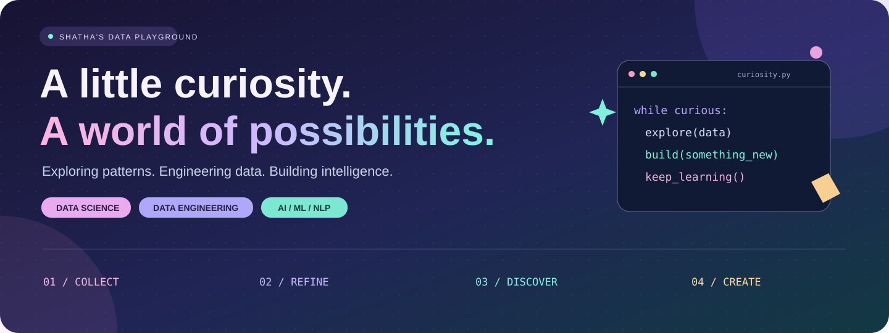
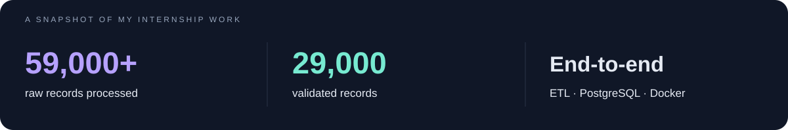

  

  <a href="#about">About</a> &nbsp; / &nbsp; <a href="#impact">Impact</a> &nbsp; / &nbsp; <a href="#projects">Projects</a> &nbsp; / &nbsp; <a href="#toolbox">Toolbox</a> &nbsp; / &nbsp; <a href="https://shatha-portfolio-ashy.vercel.app">Portfolio ↗</a>

  

### 01 — The person behind the pipelines

Hi, I'm **Shatha** 👋 A **Data Science & Artificial Intelligence graduate** building across data engineering, analytics, machine learning, and NLP.

I enjoy the entire journey: finding the right data, giving it structure, exploring its patterns, and building something useful with it. My projects connect **reliable data foundations** with **intelligent applications**.

> **My mindset:** understand the problem → question the data → build with purpose.

### 02 — Built with real data

**Beauty Cops · Data Science & AI Specialist Intern**  
August – December 2025

Contributed to the platform's technical foundation from scratch: relational schemas and ERDs, automated data collection, cleaning and validation pipelines, API integration, and Docker deployment on DigitalOcean.

### 03 — A few things I've built

<table>
<tr>
<td width="50%" valign="top">
<h3>🧠 DataMind AI</h3>

A bilingual multi-agent platform for data analysis, visualization, and retrieval-augmented generation.

<code>AI Agents</code> <code>RAG</code> <code>Analytics</code>

<a href="https://github.com/ShathaMoeen/datamind-ai">Explore project ↗</a>
</td>
<td width="50%" valign="top">
<h3>🎓 Baseera</h3>

Academic advising with GPA tracking, student performance analytics, and AI course recommendations. My role: backend development.

<code>Python</code> <code>MySQL</code> <code>BERT</code> <code>Flask</code>

</td>
</tr>
<tr>
<td width="50%" valign="top">
<h3>👁️ CIFAR-10 Classification</h3>

Exploring image classification through CNNs, data augmentation, hyperparameter tuning, and model evaluation.

<code>PyTorch</code> <code>torchvision</code> <code>CNN</code>

<a href="https://github.com/ShathaMoeen/-CIFAR10-Image-Classification.">Explore project ↗</a>
</td>
<td width="50%" valign="top">
<h3>🫀 Heart Disease Prediction</h3>

An academic ML project exploring feature engineering, dimensionality reduction, and predictive modeling.

<code>scikit-learn</code> <code>TensorFlow</code> <code>PCA</code>

<a href="https://github.com/ShathaMoeen/Heart-Disease-Prediction">Explore project ↗</a>
</td>
</tr>
</table>

<a href="https://github.com/ShathaMoeen?tab=repositories">More experiments & projects ↗</a>

### 04 — My working toolbox

**Languages & Data**

  
  
  
  
  
  
  

**Machine Learning & NLP**

  
  
  
  
  

**Build, Visualize & Deploy**

  
  
  
  
  

<b>🎓 Selected Certifications & Learning</b>

- Oracle Cloud Infrastructure 2025 Certified AI Foundations Associate
- Oracle Data Platform 2025 Certified Foundations Associate
- Supervised Machine Learning: Regression
- STC Virtual Program — Data Analysis
- Power BI for Beginners
- Improving Deep Neural Networks: Hyperparameter Tuning, Regularization and Optimization

---

  <b>Curiosity starts the question. Data helps build the answer.</b>

  

